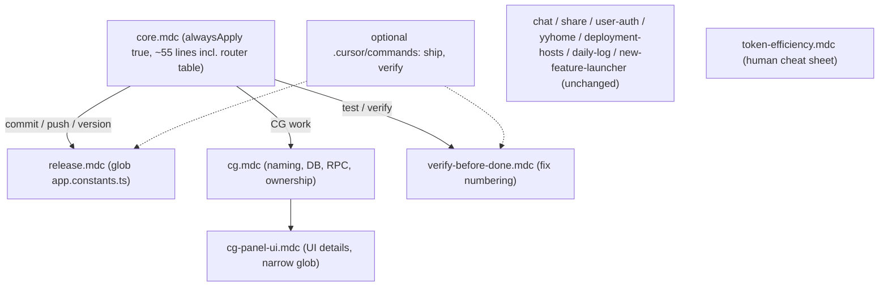

# Cursor 規則與 Token 整理計畫

## 背景結論(來自 git 歷史與 usage 資料)

- Commit `3b3d4b7`(Oct 5)把 `.cursorrules` 從 108 行壓到 56 行,**§9 Versioning & Commit Convention 被刪**。遺失:`VerX.X.X-<description>` 格式、bump 規則、先說明版本再 commit、commit 後立即 push、`tyapp_app_log` 不代寫、health check 僅在被要求時做。
- §0 仍寫「Strict git process (… conventional commits …)」,造成誤導,之後出現 `feat(cg): ...`(`00d70e5`)與 `patch version`(`091d5ed`)。
- Usage:約 1,447 筆事件,平均每筆 Cache Read 約 120 萬、Fresh Input 約 7.6 萬。規則檔(約 1.5k 到 3k)佔比小於 1% 到 4%。主要花費是長對話、agent 反覆探索、high/thinking 模型的輸出。
- 結論:規則整理是一次性的小工程。重點是補回該有的規則、讓大檔只在需要時載入,而不是把一切縮到最短。

## 最終檔案結構




## 執行步驟

### 1. 刪改清單(先給你確認,再動手)

建立一張「舊 `.cursorrules` 每條規則 → 新位置」對照表,逐條標示:保留 / 搬到某個 `.mdc` / 濃縮 / 刪除。你確認後才改檔。這是防止再被誤刪的關鍵。

### 2. 建立 `.cursor/rules/core.mdc`,刪除 `.cursorrules`

- Frontmatter:`alwaysApply: true`,description 一行。
- 內容 = 現有 `.cursorrules` 的 §0 到 §6,加下列修正:
  - §0 Let go 清單把 `conventional commits` 拿掉,改為 `PR review, branch protection`。
  - 新增 `# 7. Git: Version & Commit`:
    - Commit message 一律 `Ver4.X.X-<concise description>`,禁止 `feat(...)` 與 `fix:`。
    - Bump:新功能/頁面/route = minor(patch 歸零);修 bug/樣式/重構/文案 = patch;major 固定 4。先說明版本再等確認。
    - 升版前 `git fetch origin`,取 origin/main、HEAD、工作目錄三者最高版本(細節見 `release.mdc`)。
    - 只在被要求時 commit;commit 後立即 push(小批次)。
    - 不代寫 `tyapp_app_log` 或 Supabase,只保持版本號一致。
    - Health check / audit 只在被要求時做。
  - 新增一行模型建議:僅在新對話開頭,若任務明顯比目前模型/模式重或輕,補一句建議;否則不說,中途不重複。
  - 新增「情境路由表」(約 8 行,AI 用)。原則:程序型規則(commit、驗證、功能上線)用路由指向規則檔,約束型規則(型別、Angular、Service、樣式、soft delete)留在 always,不外移:

```markdown
# When to read other rules (read the file BEFORE acting)
- commit / push / version bump -> .cursor/rules/release.mdc
- user asks to test / verify / run regression -> .cursor/rules/verify-before-done.mdc (+ browser-must-be-visible.mdc)
- adding a feature to the Welcome launcher -> .cursor/rules/new-feature-launcher.mdc
- CG work -> cg.mdc (Panel/Desk UI: cg-panel-ui.mdc)
- auth / users / invitations -> user-auth.mdc; chat -> chat.mdc; share -> share.mdc; yyHome -> yyhome.mdc; hosts/redirects -> deployment-hosts.mdc
- Anything else: follow this file only; if the request fits no category, ask ONE clarifying question
```

- 修正 `[commit-or-keep.mdc](.cursor/rules/commit-or-keep.mdc)` 與 `[verify-before-done.mdc](.cursor/rules/verify-before-done.mdc)` 對 `.cursorrules` 的引用;同步更新 `[.cursor/regression/index.md](.cursor/regression/index.md)` 與 `[.cursorignore](.cursorignore)` 的註解。
- `eslint.config.js`、`src/app/app.routes.ts`、`src/app/styles/_page-transition.scss` 的註解提到 `.cursorrules` 章節,屬於程式碼註解,不在本次範圍,接受輕微失準。

### 3. 合併版本與 commit 相關三檔為 `release.mdc`

合併 `[app-version-on-commit.mdc](.cursor/rules/app-version-on-commit.mdc)`、`[app-version-major-4.mdc](.cursor/rules/app-version-major-4.mdc)`、`[commit-or-keep.mdc](.cursor/rules/commit-or-keep.mdc)`:

- 保留:三處取最高版本的 fetch 流程、major 鎖 4、commit-or-keep 的三段式詢問(做了什麼 / 建議版本 / 現在 commit+push 或先留著)、「先留著」時不重複 bump。
- 刪除重複的範例與已在 `core.mdc` 說明的部分。
- Frontmatter:description 明確寫「commit、push、version bump 時讀取」,glob 綁 `src/app/app.constants.ts`。目標約 25 行。

### 4. 拆分 `cg.mdc`

目標:穩定且常用的留小檔,UI 細節放大檔並縮窄 glob。

- `[cg.mdc](.cursor/rules/cg.mdc)`(約 3k token):命名鎖定表、UI words 表、Tables and columns、RPCs、Tokens 與 Storage、Host vs inner、Ownership、Save scope、Copy Layer、Do not revive。Glob 縮為 `core/domains/cg/**`、`**/cg*.service.ts`、`**/cg*.model.ts`、`supabase/sql/*cg*.sql`。
- `cg-panel-ui.mdc`(新,約 5k token):Panel layout、Edit mode(Studio/Direct)、Logo desk Studio、Controls & heights、Always desktop、Buttons 規範、No global toolbar、On air/Pending、Layer desk monitors/shell、Subtitle cue 與 Logo/Subtitle 的顯示細節。Glob 只綁 `cg-package-edit.*`、`cg-layer-edit.*`、CG 的 scss 與 overlay 樣式。
- 濃縮歷史敘述:`_cg-theme.scss` 被刪、overlay 舊輪詢等各縮成一句「不要重建/不要回退」。
- Studio / Direct / Logo Draft 的規則改用表格,降低模型誤判。

### 5. 重寫 `token-efficiency.mdc` 為給你自己看的速查表

- 過時的 Flash/Haiku/o3-mini 分級,換成你實際可選的三級:
  - L1 日常(約 80%):Auto 或 Sonnet 5.5 low。
  - L2 中型:Sonnet 5.5 medium/high(不開 thinking)。
  - L3 少用(RLS/RPC 設計、L2 解不開的 bug、架構取捨):thinking-high,僅在 Ask/Plan。
- 四個維度說明:模型家族、強度(low/medium/high/max 與 thinking)、fast、Max Mode(維持關閉)。
- 模式選擇四問:只討論 → Ask;多檔案或不確定 → Plan;猜不出原因的 bug → Debug;範圍明確 → Agent。
- 類別判斷順序(最多 4 問):要不要改檔案?(不要 → A/B);跟 git 或版本有關?(→ I);要我測試?(→ H);其餘依改動大小、是否碰資料庫、是否未知原因的 bug 落在 C/D/E/F。
- 11 類情境清單(每個請求只落一類),整張表放在這個檔案給你看:


| 類別        | 典型請求                               | 模式               | 模型           | 要讀的規則                                                |
| --------- | ---------------------------------- | ---------------- | ------------ | ---------------------------------------------------- |
| A 理解與提問   | 解釋程式、找位置、比較做法、審查                   | Ask              | L1(複雜架構 L2)  | core                                                 |
| B 規劃與設計   | 多檔案、不確定做法                          | Plan             | L2 或 L3      | core + 功能規則;完成後新對話執行                                 |
| C 小修改     | 樣式、文案、單檔、lint                      | Agent            | L1           | core                                                 |
| D 功能與多檔變更 | 新頁面、route、service、元件               | Agent            | L2           | core + 功能規則;上 Welcome 加 new-feature-launcher         |
| E Bug     | 已知原因 = C 或 D;未知原因 = Debug          | Debug 或 Agent    | L2,2 次無解升 L3 | core                                                 |
| F 資料庫     | SQL、RPC、RLS、遷移                     | Plan 再 Agent     | 設計 L3,實作 L2  | core 第 3 節;牽涉 auth 或 chat 讀對應規則;新 SQL 放 supabase/sql |
| G 領域功能    | CG、yyHome、Chat、Share、Daily Log、Fit | 同 C 或 D          | 同 C 或 D      | 功能規則(glob 自動載入)                                      |
| H 驗證與測試   | 明確要求才做                             | Agent            | L2           | verify-before-done、browser-must-be-visible;先請你開 ng s |
| I 發佈      | commit、push、版本                     | Agent(或 Ask 先提案) | L1           | release.mdc                                          |
| J 維護工具    | 改規則、看 usage                        | Plan 再 Agent     | L2           | 本計畫;先給刪改清單                                           |
| K 其他      | 不屬於以上                              | Ask              | L1           | core;先問一個釐清問題                                        |


- 標準流程:Plan(L3)定方案 → 新對話 Agent(L1/L2)執行 → commit → 關閉對話。
- 指令模板(目標 / `@檔案` / 限制 / 完成條件 / 不確定時先問)。
- 每週看一次 Usage 頁,找最貴的對話。

### 5b. 選用:自訂指令(需先確認 Cursor 是否支援)

- 先由你在聊天框輸入 `/`,看有沒有自訂指令選項。不支援就跳過這一步,路由表已提供保險。
- 支援的話,在 `.cursor/commands/` 建立:
  - `ship.md`(類別 I):先 `git fetch origin` 取三處最高版本;提案 bump 與 `Ver4.X.X-<description>`;等你確認;commit;立即 push;不碰 `tyapp_app_log`。
  - `verify.md`(類別 H):驗證報告流程,先確認你已開 `ng s`,瀏覽器分頁必須可見,Super Admin 專屬案例標 `Needs Super Admin`。
  - 選用 `plan.md`(類別 B):計畫輸出格式與要問的 1 到 2 個關鍵問題。
  - 選用 `rules.md`(類別 J):先列刪改清單給你確認,全域行為規則(commit、語言、版本)不可搬到 glob 規則。
- 這些檔案內容只在你輸入 `/名稱` 時才載入,平常成本為 0。與 `core.mdc` 路由表並用,你忘了打指令時由路由表兜底。

### 6. 修正 `verify-before-done.mdc` 編號

`[verify-before-done.mdc](.cursor/rules/verify-before-done.mdc)` 目前「1. 2.」後被 Login 區塊切斷,才出現「3. 4.」,只調整編號與順序,不改內容。

### 7. 驗證與收尾

- 用 Grep 逐條核對對照表:舊 `.cursorrules` 每條規則都能在新檔找到,或明確標為刪除。
- 確認不再有 `.cursorrules` 的懸空引用(`§9` 等)。
- 這次只動規則/文件,不需 lint 或瀏覽器驗證。
- 依 `release.mdc`:先 `git fetch origin`,取最高版本,提出 `Ver4.X.X-<description>` 與 bump 建議,等你確認後 commit 並立即 push。建議訊息範例:`Ver4.107.6-Restore git rules and reorganize cursor rules`(版本號需以 fetch 結果為準)。

## 你要做的事

- 執行方式:另開一個**新對話**,Agent mode,模型用 L2(Sonnet 5.5 high 或 medium),附上這份計畫。不要在這個長對話內執行,避免背著大量歷史。
- 在 Usage 頁面看各模型的實際金額,把最貴的兩個降級使用。
- 確認 L1/L2/L3 要用哪些模型(預設如上),以及你說的「Multitask」是什麼功能。
- 在聊天框輸入 `/`,確認是否有自訂指令功能,並告訴執行的 agent(決定是否做 5b)。
- 每個新任務開始前,先照速查表的 11 類挑模式與模型,不要在對話中途換模型。

## 完成後預期

- 每輪固定載入:`core.mdc` 約 55 行(含路由表,比現在多約 15 行,但不再漏規則;約束型規則維持 always)。
- 程序型規則(commit、驗證、功能上線)只在對應情境才讀取,觸發點由路由表或 `/ship`、`/verify` 保證。
- CG 工作時載入:小檔 + 只在編輯 Panel/Desk 檔案時才載入 UI 大檔,取代現在每次整份載入。
- commit 流程回到 `Ver4.X.X-...` 加立即 push,不再依賴模型是否碰巧讀到某個 glob 規則。

